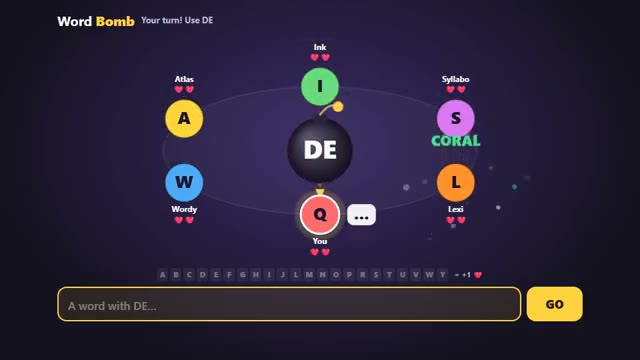

# Word Fuse

Type a word with the letters before the bomb pops. A multiplayer starter game from [Multiplayer Agent](https://multiplayeragent.com): 2D, party, 2–12 players, with bots that fill empty seats.

## How it plays

The bomb shows two or three letters: on your turn, type any word that contains them and hit Enter to pass it on. No repeats, two lives each, last one standing wins.

**Controls:** Type on the keyboard (or your phone's keyboard) and press Enter or GO.

## Make it yours in the Game Builder

Open the [Game Builder](https://multiplayeragent.com), choose **Start from a starter game** and pick Word Fuse. It opens as version 1 in your studio, ready to play and publish. Then ask for changes, for example:

- Make the bomb a ticking alarm clock in a spooky castle
- Give a bonus life for words longer than 8 letters
- Add a category round where every word must be an animal

## Run it yourself

1. Get a free publishable key (`pk_…`) at [multiplayeragent.com](https://multiplayeragent.com).
2. In `index.html`, put it in place of `pk_REPLACE_ME` in the `MP_CONNECT` block.
3. Open `index.html` in a browser. No build step and no server needed.

Without a key it still runs, offline against bots.

## How it is built

- One `index.html`. The comment at the top of the script maps the code and explains the multiplayer. The word list sits in its own script block at the top.
- **Leaderboard:** Games won, all time, shown on the results card.
- **Bots:** Bots fill the circle, type at a human pace and sometimes blunder.
- **Host-run rules:** The host's browser checks every word and runs the hidden fuse; if it leaves, the next player takes over.
- **Live sync:** Everyone watches the letters appear as the player with the bomb types.
- `?attract` runs it offline with bots only. The preview video is recorded from it.

## License

MIT.
